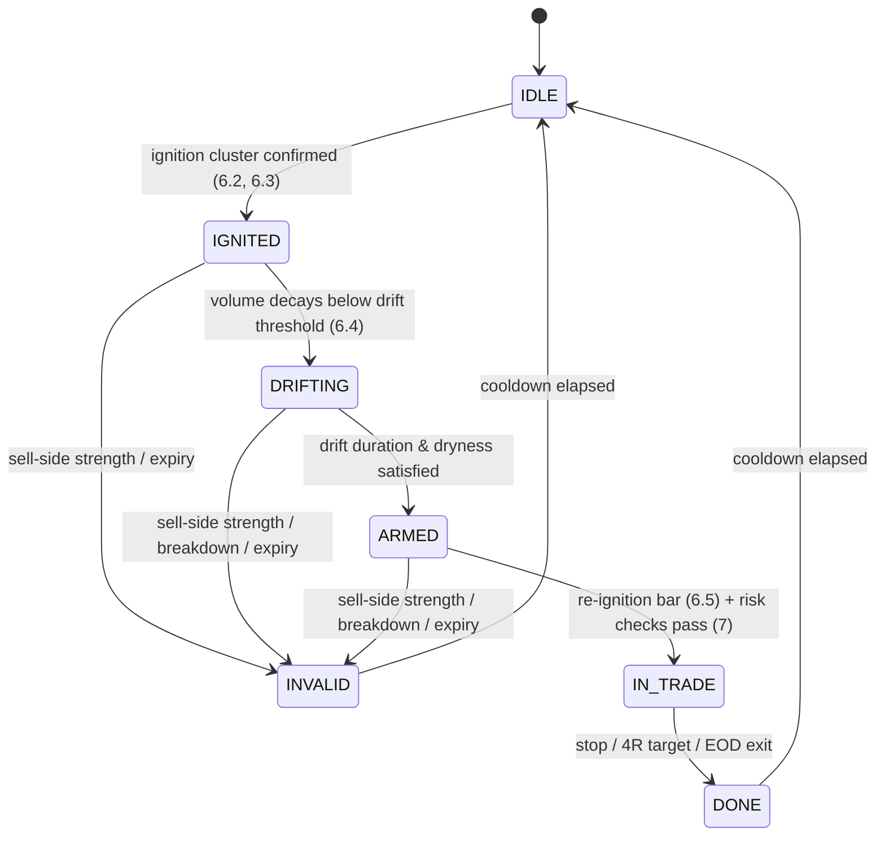
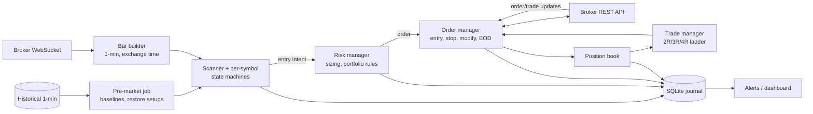

# Imbalance Bot: Implementation Spec

Algorithmic implementation of Ravindra Rokade's intraday "institutional imbalance" strategy for NSE cash equities.

| | |
|---|---|
| Status | Draft v0.2: spec only, nothing implemented. v0.2 adds §18 (related methods and alternative rule definitions) |
| Sources | [Setup video](https://www.youtube.com/watch?v=LsT0V2AgPak) ([article](../out/LsT0V2AgPak/article.md)) · [Podcast](https://www.youtube.com/watch?v=-3HD0quIvMk) ([article](../out/-3HD0quIvMk/article.md)) |
| Market | NSE cash equity, intraday (MIS), long-only by default |
| Timeframe | 1-minute bars |

> **Read this first.** The source is two talk-show videos, not a published system. Rokade gives thresholds for the screener and the trade management, but describes the entry pattern in words ("volume dies", "the institution starts buying again"). This spec turns every vague rule into a **named, configurable parameter** and records how it was interpreted (§10). None of the defaults have been backtested. By his own account the edge comes from risk-reward and discipline, not from the entry, and he expects to be right only ~20–30% of the time. **Validate everything in backtest and paper trading before risking capital (§13–14). Not financial advice.**

---

## 1. The strategy on one page

**Thesis.** Price moves only on **imbalance**: demand and supply so lopsided that one side can't be filled at one price. The market has two kinds of participant, retail (R) and institution (I), so there are three kinds of trade:

| Trade | Volume | Candle | Imbalance | Bot action |
|---|---|---|---|---|
| R ↔ R | small | small | no | ignore (the ~70% sideways chop) |
| I ↔ I | **huge** | small (fills at one price) | no | **reject** |
| R ↔ I | **huge** | **huge** | **yes** | candidate |

**The trade, in three stages:**

1. **Ignition.** A stock prints exceptional volume, far above its 3-day per-minute average and above a rupee floor, together with large candles. An institution is buying aggressively. *Shortlist it; don't buy yet.*
2. **Drift (absorption).** Price pulls back or goes sideways on **small candles and dying volume**. That's retail selling on "overbought / resistance / trendline" signals while the institution absorbs on limit orders. *Wait. Cancel if heavy volume appears on the downside (the institution is selling: "A-shape").*
3. **Re-ignition.** Volume comes back on the buy side: the institution is still interested. **Buy immediately**, stop at the drift's swing low.

**Risk and management:** risk **1% of capital** per trade. At +2R move the stop to entry, at +3R move it to +1R, at +4R **exit everything**. Square off by **15:20**. Expect many small losses and a few 4R wins:

```
10 trades @ 1% risk, 3 winners at 1:4:   3×4% − 7×1% = +5% per month (his example)
```

---

## 2. Scope

**In scope (v1)**
- NSE cash equities, intraday (MIS), **long side**.
- Live scanning of a configurable universe (default: Nifty 500 plus mid caps, per his statement).
- Automatic entry, a broker-side stop, the trailing ladder, time-based square-off.
- An event-driven backtester that shares the signal and risk code with the live bot.
- A paper-trading mode.
- A journal, including **post-exit tracking** of each trade (his mentor's lesson: study what the chart did after you exited).

**Out of scope (v1)**
- **Short side.** He says heavy sell-side volume means "short", but gives no worked example. It's specified as a mirror behind a flag (§6.6), off by default.
- **Index and options trading.** He discourages options for new traders. The "Nifty momentum day" heuristic (candles 4–5× the average size) is noted in Appendix B only.
- Swing or positional holding, and multi-leg or partial exits (he exits the whole position at 4R).

---

## 3. Glossary

| Term | Meaning in this spec |
|---|---|
| **Bar** | A 1-minute OHLCV candle. Bar `t` is final only at its close. |
| **Turnover** `TV(t)` | Rupee value traded in bar `t` = `volume × typical_price`, where `typical_price = (H+L+C)/3` (or VWAP if the feed provides it). |
| **Baseline volume** `BV` | Mean 1-min volume over the previous `baseline_sessions` (default 3) full sessions. Excludes the first and last `baseline_trim_min` minutes (default 5), where the open and close auctions distort volume. |
| **Baseline range** `BR` | Mean 1-min high−low over the same window. |
| **Ignition bar** | A bar that passes the ignition filter (§6.2). |
| **Ignition cluster** | The set of qualifying ignition bars within `cluster_window_min` minutes. |
| **Drift** | The period after ignition in which the bot watches for absorption. |
| **R** | Initial risk per share = `entry − initial_stop`. |
| **Swing low** | The lowest low of the drift segment (§6.4). |

---

## 4. Market assumptions (NSE)

- **Session:** 09:15–15:30 IST. Pre-open 09:00–09:08 is ignored for signals.
- **MIS auto square-off:** the broker's cut-off is usually ~15:20–15:25. **The bot squares off itself at `eod_exit_time` = 15:20** (his exit time on every example trade) and never relies on the broker's square-off.
- **Tick size and price bands** come from the exchange instrument master every day. Never hard-code them.
- **Circuit limits:** a stock in a narrow price band (2%/5%) can lock at its circuit on a large order. Rokade: *"those stocks are so small that ₹4 Cr puts them at the 5% circuit"*. Handled in §6.2.
- **Leverage:** intraday equity gives ~5× (he cites ₹1 L → ₹5 L). Use the broker's actual MIS margin per stock.

---

## 5. Data requirements

| Data | Source | Frequency | Used for |
|---|---|---|---|
| Instrument master (symbol, token, tick size, lot, price band, circuit limits, MIS eligibility) | Broker or NSE | Daily, pre-market | Universe, rounding, filters |
| Historical 1-min OHLCV, ≥ `baseline_sessions` + 1 sessions | Broker historical API | Daily, pre-market | `BV`, `BR`, drift state that carries across days |
| Live ticks or 1-min bars for the whole universe | Broker WebSocket | Streaming | Everything |
| Historical 1-min OHLCV, ≥ 2 years | Broker or vendor | One-off | Backtesting |
| Corporate actions (splits, bonuses) | Exchange | Daily | Adjusting baselines and history |

**Notes**
- Build 1-min bars from ticks yourself when the broker only streams ticks. Use **exchange timestamps**, not local receive time.
- Volume must be **traded (executed) volume**. Rokade explicitly distrusts order-book depth ("total buy quantity"), because pending orders can be cancelled. **Never use bid/ask quantities as a signal.**
- Universe size is ~500–2,000 symbols. Check your broker's WebSocket subscription limit; you may need several connections.

---

## 6. Signal model

### 6.1 Per-symbol state machine



**This state carries across sessions.** In his BEML example the ignition was on Friday 23 May 2025 and the entry on Monday 26 May, so `IGNITED`, `DRIFTING` and `ARMED` must be persisted and restored the next morning. Positions, on the other hand, never carry over (intraday only).

A setup expires after `setup_max_sessions` (default 3) sessions without an entry.

### 6.2 Stage A: the ignition filter (per closed bar)

A bar `t` of symbol `s` is an **ignition bar** when all of the following hold:

| # | Condition | Default | Source |
|---|---|---|---|
| A1 | `volume(t) ≥ vol_mult × BV` | `vol_mult = 20` | "4 cr 20 times": current bar ≥ 20× the 3-day average 1-min volume |
| A2 | `TV(t) ≥ min_turnover` | ₹4 Cr | Same scan. Rises over time (₹1 Cr in 2016 → ₹4 Cr in 2025); he trades only ≥ ₹10 Cr himself |
| A3 | `range(t) ≥ range_mult × BR` | `range_mult = 4` | R↔I needs **big candles**. Big volume with a small candle = I↔I, reject |
| A4 | `close(t) > open(t)` (long side) | – | Buying imbalance |
| A5 | Not within `circuit_buffer_pct` of the upper circuit, and price band ≥ `min_price_band_pct` | 1.5%, 10% | Avoids circuit-locked micro caps |
| A6 | Symbol in the universe and MIS-eligible | – | – |

Alternative scan from the setup video (enable as a second rule set): `vol_mult = 10`, `min_turnover = ₹6 Cr`.

### 6.3 Ignition cluster ("buying in a bunch")

He wants proof the institution is buying *continuously* ("20–25 Cr trades for 5 minutes straight", "6–7 candles ≈ ₹60–70 Cr"). One freak print isn't enough:

- **C1:** at least `cluster_min_bars` (default 3) ignition-grade bars within `cluster_window_min` (default 10) minutes. Bars 2..n may use a relaxed volume multiple `cluster_vol_mult` (default 10×) but must still meet A2.
- **C2 (optional, "dwarfing"):** the cluster's peak volume ≥ `dwarf_mult` (default 3) × the maximum 1-min volume of the baseline window, so the prior volume "goes into the ground". Off by default. Enable it if C1 alone lets through too much noise.

When C1 holds → `IGNITED`. Record:
`ign_start`, `ign_end`, `ign_high` (highest high in the cluster), `ign_low`, `ign_avg_vol` (mean cluster volume), `ign_turnover` (sum).

### 6.4 Stage B: drift and absorption

After `ign_end`, compute on each closed bar:

- `drift_vol = SMA(volume, drift_sma_bars)`, default 10 bars
- `drift_range = SMA(range, drift_sma_bars)`

**Enter `DRIFTING` when** `drift_vol ≤ drift_dry_ratio × ign_avg_vol` (default 0.10, meaning volume has fallen to ≤10% of the ignition level).

**Become `ARMED` when all of these hold:**
- B1: in `DRIFTING` for ≥ `drift_min_bars` (default 15) bars. This counts across sessions: bars from previous days count.
- B2: dryness is sustained: `drift_vol ≤ drift_dead_ratio × ign_avg_vol` (default 0.05) at least once. That's the "volume completely dead" state before his IFCI and BEML entries.
- B3: small candles: `drift_range ≤ drift_range_mult × BR` (default 2).

**Invalidate (→ `INVALID`) on any of:**

| # | Condition | Default | Rationale |
|---|---|---|---|
| X1 | A **red** bar with `volume ≥ sell_vol_mult × BV` and `TV ≥ min_turnover` | 20×, ₹4 Cr | Institution selling: the "A-shape". *"If it's coming down on big volume, I'm not interested."* |
| X2 | Close below `ign_low − breakdown_buffer × (ign_high − ign_low)` | buffer 0.25 | The whole ignition leg has been given back |
| X3 | Setup older than `setup_max_sessions` | 3 | Stale |
| X4 | Stock hits the lower circuit, or is suspended | – | – |

> He explicitly says the drift **may** break the previous low without killing the setup, as long as no *strength* shows on the downside. That's why X1 (sell-side volume) is the main invalidation, and X2 is only a loose backstop.

**Swing low** = the lowest low from `ign_end` up to the bar before the trigger.

### 6.5 Stage C: re-ignition (entry trigger)

In `ARMED`, a closed bar `t` triggers an entry when all of these hold:

| # | Condition | Default |
|---|---|---|
| E1 | `close(t) > open(t)` | – |
| E2 | `volume(t) ≥ reign_vol_mult × drift_vol` | 5× |
| E3 | `TV(t) ≥ reign_min_turnover` | ₹1 Cr |
| E4 | *(optional)* `close(t) > max(high)` of the last `reign_break_bars` bars | off; 10 |
| E5 | Time between `no_entry_before` and `no_entry_after` | 09:16, 14:30 |
| E6 | Initial stop distance `(entry − stop)/entry ≤ max_stop_pct` | 3% |
| E7 | Risk checks in §7 and §9 pass | – |

- **Entry:** a marketable **limit** order at `close(t) + entry_slippage_ticks × tick` (default 3 ticks), sent immediately after the bar closes. Cancel it if it isn't filled within `entry_timeout_s` (default 20 s); the setup stays `ARMED`.
- **Initial stop:** `swing_low − stop_buffer_ticks × tick` (default 2 ticks), rounded **down** to the tick size.
- E9 (timing, as he states it): *"The moment it starts buying again, without a single thought in mind, I buy."* Don't wait for extra confirmation beyond the listed rules.

> **Why E6 exists.** A drift can be deep. His examples had stops of ~1% (BEML, a 40 pt stop on ~₹3,850) and ~2% (IFCI, ₹1.20 on ₹57). A 6% stop is a different trade with a different fill quality, so skip it.

### 6.6 Short side (disabled by default)

A mirror image: A4 becomes a red bar, the drift is a relief rally on dying volume, re-ignition is a red high-volume bar, and the stop is the drift's swing high. Additional constraints: the stock must be shortable intraday, and there must be no lower-circuit proximity. Enable with `short_enabled: true` **only after a separate backtest**.

---

## 7. Position sizing ("trade for loss")

The risk amount is decided **before** entry, and treated as already given away.

```
risk_amount   = equity_start_of_day × risk_pct              # default risk_pct = 1%
R_per_share   = entry_price − initial_stop
qty_risk      = floor(risk_amount / R_per_share)
qty_leverage  = floor(equity × mis_leverage / entry_price)  # broker MIS margin, ~5×
qty_liquidity = floor(liq_cap_pct × ign_avg_turnover_per_min / entry_price)   # default 5%
qty           = min(qty_risk, qty_leverage, qty_liquidity)
if qty × R_per_share < min_risk_fraction × risk_amount: skip  # sizing too distorted by caps; default 0.5
```

- **Fixed rupee risk per trade is the core rule.** *"Some trades lose ₹500, some ₹5,000, some ₹20,000. That itself may be the reason for your losses."*
- `liq_cap_pct` puts his remark into numbers: his ₹50 L position is invisible in a stock trading ₹10+ Cr a minute, but would cause its own slippage in a ₹1 Cr/min stock.
- Worked example (his): capital ₹1,00,000 → risk ₹1,000. With a 40-pt stop, qty = 25.

---

## 8. Trade management

Let `R` = the initial risk per share. Evaluate on every tick or bar, using the **highest price since entry** (MFE):

| Trigger (unrealised) | Action | His words |
|---|---|---|
| +2R | Move the stop to **entry** (breakeven) | "I offered you ₹1,000, you didn't take it. Now I won't give even ₹1." |
| +3R | Move the stop to **entry + 1R** | "At least what I was willing to give, I want back." |
| +4R | **Exit the whole position** (limit at 4R, or market once touched) | "At 1:4, without any hesitation, square off." |
| `eod_exit_time` (15:20) | Exit at market | Every example trade was closed at 3:20 pm |

Rules:
- **Stops sit at the broker** (SL-M or SL-limit) from the moment of fill. Trailing = modifying the resting order. Never keep a stop only in bot memory.
- **Only move stops up.** Never widen one.
- No discretionary or early exits. The US prop desk rule he credits: *a trader may never close a winning position; only the stop or the admin does.*
- **Why cap at 4R rather than let it run** (his math): of 10 trades that reach 1:4, maybe 2 reach 1:10 (+20%). But trailing for them sends the other 8 back to breakeven (−32% of forgone profit), whereas 10 × 4R = +40%. Make it a parameter (`target_R = 4`) and **test it**: it's the most debatable rule.

---

## 9. Portfolio and session rules

| Rule | Default | Note |
|---|---|---|
| `max_open_positions` | 3 | He took 3 trades (BEML, IFCI, Solar) the same day |
| `max_trades_per_day` | 5 | Anti-overtrading; he stresses long holds and few trades |
| `daily_loss_limit` | 3% of equity (3R) | Stop opening new trades for the day |
| `max_sector_positions` | 2 | Correlation guard (not from the source) |
| `one_entry_per_setup` | true | After a stop-out, the setup goes to `DONE`, not back to `ARMED` |
| `symbol_cooldown_sessions` | 1 | – |
| `no_entry_after` | 14:30 | A new trade needs time to reach 4R before 15:20 |
| Kill switch | manual + automatic | Automatic on: feed stale > 30 s, order rejects > 3 in 5 min, position mismatch with the broker |

---

## 10. Parameters and interpretation log

Everything configurable lives in one file. **Where a default is an interpretation, it's marked 🟡** and must go through the sensitivity analysis in §13.4.

```yaml
# config.yaml
universe: nifty500_plus_midcap       # "mid caps, Nifty 500, some small caps"
baseline_sessions: 3                 # stated
baseline_trim_min: 5                 # 🟡
ignition:
  vol_mult: 20                       # stated ("20 times")
  min_turnover_inr: 4.0e7            # stated (₹4 Cr, 2025); he personally uses ≥ ₹10 Cr
  range_mult: 4                      # 🟡 ("huge candle")
  circuit_buffer_pct: 1.5            # 🟡
  min_price_band_pct: 10             # 🟡 (excludes 2%/5% band stocks)
  alt_rule: {vol_mult: 10, min_turnover_inr: 6.0e7}   # stated ("6 cr 10 times")
cluster:
  min_bars: 3                        # 🟡 ("continuously for 5 min", "6–7 candles")
  window_min: 10                     # 🟡
  vol_mult: 10                       # 🟡
  dwarf_mult: null                   # 🟡 optional ("previous 90% disappears")
drift:
  sma_bars: 10                       # 🟡
  dry_ratio: 0.10                    # 🟡 ("volume reducing")
  dead_ratio: 0.05                   # 🟡 ("volume completely dead")
  min_bars: 15                       # 🟡
  range_mult: 2                      # 🟡 ("small candles")
  sell_vol_mult: 20                  # 🟡 mirror of ignition
  breakdown_buffer: 0.25             # 🟡
setup_max_sessions: 3                # 🟡 (BEML: Fri ignition → Mon entry)
entry:
  reign_vol_mult: 5                  # 🟡 ("institution starts buying again")
  reign_min_turnover_inr: 1.0e7      # 🟡
  reign_break_bars: null             # 🟡 optional
  slippage_ticks: 3
  timeout_s: 20
  no_entry_before: "09:16"           # Solar entry was 09:16–09:17
  no_entry_after: "14:30"            # 🟡
  max_stop_pct: 3.0                  # 🟡
  stop_buffer_ticks: 2               # 🟡
risk:
  risk_pct: 1.0                      # stated
  mis_leverage: 5                    # stated (use broker value)
  liq_cap_pct: 5                     # 🟡 derived from his ₹50 L vs ₹10 Cr remark
  min_risk_fraction: 0.5             # 🟡
management:
  breakeven_at_R: 2                  # stated
  lock_1R_at_R: 3                    # stated
  target_R: 4                        # stated
  eod_exit_time: "15:20"             # stated
portfolio:
  max_open_positions: 3
  max_trades_per_day: 5
  daily_loss_limit_pct: 3
  max_sector_positions: 2
short_enabled: false
mode: paper                          # backtest | paper | live
```

**What he actually said, per rule** (for reviewers):

| Rule | Source quote (translated) | Video @ time |
|---|---|---|
| Screener | "current 1-min bar volume should be 20 times the average 1-min volume of the last three days… and 4 crore" | Setup @ 15:49 |
| Rising floor | "₹1 Cr in 2016 … 2 Cr … 3 Cr … today in 2025 it's 4 Cr; in 2026 it may be 8–10 Cr" | Podcast @ 43:09 |
| I↔I rejection | "huge volume bar, but the candle is like retail's, because it all traded at one rate" | Setup @ 10:29 |
| Drift | "volume reduces and it goes sideways on small candles: 100% retail is trading here" | Setup @ 20:54 |
| Dead volume | "wait until volume becomes completely dead… no liquidity left even to accumulate" | Setup @ 35:37 |
| Invalidation | "if the institution is selling and bringing it down like this, I'm not interested" | Setup @ 21:08 |
| Entry | "as soon as he starts buying again, without a single thought, I buy and keep the stop at the swing low" | Setup @ 32:06 |
| Sizing | "only as much quantity that my capital takes a 1% dent" | Setup @ 33:06 |
| Ladder | "at 1:2 I trail to cost… at 1:3 I trail to 1… at 1:4 square off without hesitation" | Setup @ 38:07–39:07 |

---

## 11. Reference architecture

Keep it one process and boring. The whole strategy is a few thousand symbol-minutes per session.



| Component | Responsibility | Notes |
|---|---|---|
| Pre-market job (08:30) | Refresh the instrument master, compute `BV`/`BR` for every symbol, restore unexpired setups | Idempotent; re-runnable |
| Bar builder | Ticks → 1-min bars with exchange timestamps; emits `bar_closed` | A bar closes when the first tick of the next minute arrives **or** at `minute + grace_ms` (default 1500 ms) |
| Scanner | Runs §6 on each `bar_closed`; pure functions over bar history + state | **Shared unchanged with the backtester** |
| Risk manager | §7 sizing, §9 limits; can veto | Pure function |
| Order manager | Places the entry, attaches the stop on fill, modifies the stop, EOD exit; reconciles with the broker | Uses client order IDs for idempotency |
| Trade manager | §8 ladder from ticks | Only ever tightens stops |
| Journal | Every signal, state change, order, fill and P&L, plus **post-exit tracking** (§15) | SQLite; one file per environment |

**Failure handling**
- **Feed drops:** stops are already at the broker, so positions stay protected. Pause new entries until the feed has been healthy for 60 s. A kill switch fires if it's stale for more than 30 s during market hours.
- **Bot crash or restart:** on boot, **reconcile with the broker** (orders, positions) before anything else. Adopt any open position and make sure it has a stop.
- **Stop order rejected:** retry once, then exit the position at market and alert.
- **Partial entry fill at timeout:** keep the filled quantity and size the stop for it; cancel the rest.
- **Clock:** NTP-synced host. All logic uses exchange timestamps.

**Broker choice:** anything with WebSocket ticks, 1-min history and bracket/SL-M orders (e.g. Dhan, Zerodha Kite Connect, Fyers, Upstox). He chart-reads on a Dhan layout, but nothing here depends on it. Wrap the broker behind one small adapter module.

---

## 12. Core logic (pseudocode)

```python
def on_bar_closed(sym, bar, st, cfg):
    h = st.history                      # rolling bars incl. previous sessions
    if st.state == IDLE:
        if is_ignition(bar, st.baseline, cfg.ignition):
            st.cluster.append(bar)
            st.cluster = [b for b in st.cluster if bar.t - b.t <= cfg.cluster.window_min]
            if len(st.cluster) >= cfg.cluster.min_bars:
                st.ign = summarize(st.cluster)          # start, end, high, low, avg_vol, turnover
                st.state = IGNITED
        return

    if sell_side_strength(bar, st.baseline, cfg) or broken_down(bar, st.ign, cfg) \
            or expired(st, cfg):
        st.state = INVALID
        return

    dv, dr = sma(h.volume, cfg.drift.sma_bars), sma(h.range, cfg.drift.sma_bars)
    if st.state == IGNITED and dv <= cfg.drift.dry_ratio * st.ign.avg_vol:
        st.state, st.drift_bars = DRIFTING, 0
    if st.state == DRIFTING:
        st.drift_bars += 1
        st.went_dead |= dv <= cfg.drift.dead_ratio * st.ign.avg_vol
        if st.drift_bars >= cfg.drift.min_bars and st.went_dead \
                and dr <= cfg.drift.range_mult * st.baseline.range:
            st.state = ARMED
    if st.state == ARMED and is_reignition(bar, dv, cfg.entry):
        stop = round_down(swing_low(h, since=st.ign.end) - cfg.entry.stop_buffer_ticks * tick(sym), tick(sym))
        if (bar.close - stop) / bar.close * 100 <= cfg.entry.max_stop_pct:
            emit(EntryIntent(sym, ref_price=bar.close, stop=stop, ign=st.ign))


def is_ignition(b, base, c):
    return (b.volume >= c.vol_mult * base.vol
            and b.volume * typical(b) >= c.min_turnover_inr
            and (b.high - b.low) >= c.range_mult * base.range
            and b.close > b.open
            and not near_upper_circuit(b, c.circuit_buffer_pct))


def manage(pos, price, cfg):             # on every tick while IN_TRADE
    pos.mfe = max(pos.mfe, price)
    r = (pos.mfe - pos.entry) / pos.R
    if r >= cfg.target_R:
        exit_all(pos)
    elif r >= cfg.lock_1R_at_R:
        raise_stop(pos, pos.entry + pos.R)
    elif r >= cfg.breakeven_at_R:
        raise_stop(pos, pos.entry)
```

**Tests the implementation must include** (one small `test_*.py` per module):
- `is_ignition` rejects big volume with a small candle (I↔I).
- The state machine carries `ARMED` across a session boundary (the BEML Fri → Mon case).
- `raise_stop` never lowers a stop.
- Sizing: ₹1 L equity, 1% risk, 40-pt stop → 25 shares. Capped by leverage and by liquidity.
- The ladder: price path +2.1R → +3.2R → +1.1R exits at +1R, not at breakeven.

---

## 13. Backtesting

### 13.1 Engine
- **Event-driven**, replaying 1-min bars (tick replay if available) through **the same scanner, risk and trade-manager code** as live.
- Signals use only **closed** bars. An ignition bar's volume isn't known until it closes, so entries fill **no earlier than the next bar**.
- Carry setup state across days, as live does.

### 13.2 Fill model
| Event | Fill assumption |
|---|---|
| Entry | Next bar's open + `max(entry_slippage_ticks, 0.05% × price)`. No fill if the next bar gaps beyond the limit |
| Stop | Stop price − slippage; on a gap through the stop, fill at the bar's open |
| 4R target | Limit fill only if the bar's high trades **strictly through** the target |
| EOD | 15:20 bar's close − slippage |
| Same-bar ambiguity (stop and target both touched) | **Assume the stop hit first** |

### 13.3 Costs (Indian intraday equity; verify current rates)
Brokerage (flat or % per order), STT 0.025% on the sell side, exchange transaction charges, SEBI turnover fee, stamp duty 0.003% on the buy side, and GST 18% on brokerage + exchange charges. Model these as a per-trade function; at 1% risk with ~1% stops, costs can eat a real share of 1R.

### 13.4 Methodology
- **Period:** at least 2 years, including a crash and a trending regime. Watch for the regime shift he describes around 2020 (retail participation rose, so the turnover floor had to rise).
- **Point-in-time universe:** use index membership as of each date, delisted stocks included (no survivorship bias). Adjust for corporate actions.
- **Walk-forward:** tune on window N, test on window N+1. Never report in-sample results.
- **Sensitivity:** sweep every 🟡 parameter ±50%. A robust edge degrades smoothly; a cliff means overfitting.
- **Ablations:** (a) enter at ignition, with no drift wait; (b) no cluster rule; (c) `target_R` ∈ {2, 3, 4, 6, trail-only}; (d) the alternative 10×/₹6 Cr scan; (e) the rule-definition presets from established methods (Wyckoff/VSA, VCP, Pocket Pivot, Qullamaggie) in §18.2. This checks which parts of his method actually carry the edge.

### 13.5 Metrics to report
Win rate · average win/loss in R · expectancy (R/trade) · SQN (§18.2 V9) · profit factor · max drawdown (R and %) · longest losing streak · trades per month · % of trades exited at 4R / breakeven / stop / EOD · exposure time · cost drag · **post-exit MFE** (§15).

**Sanity target from his claims:** win rate ~20–35%, average winner ~3–4R, expectancy > 0.3R after costs. If the backtest shows a 60% win rate with 1R winners, something is wrong (look-ahead bias or fill model).

### 13.6 Golden cases from the videos
Replay these dates and check that the state machine fires **approximately** where he did. Chart times were read from screenshots, so treat them as ±a few minutes, and his trade dates are inferred (recording on 27 May 2025 per the on-screen clock; "yesterday" = Mon 26 May 2025).

| Symbol | Ignition | Drift | His entry | His exit |
|---|---|---|---|---|
| BEML | Fri 23 May 2025 ~13:41–13:52; ~57,000 shares/min at ~₹3,700 | 23–26 May, ~₹3,700–3,780, dry volume | Mon 26 May, around 11:30 as the rally starts (the measure tool starts at 11:37) | Booked at 1:4. The stock then ran +18.4% into the 27th |
| IFCI | ~22–23 May 2025, ₹50 → ~₹56 | −3.12% pullback to ~₹54.7 on falling volume | Mon 26 May 10:47 @ ₹57, stop ≈ ₹55.80 (₹1.20) | Topped ~₹59.90, trailed stop, closed at 15:20 |
| Solar Industries | Wed 21 May 2025 09:51, ~₹14–15 Cr/min for 6–7 bars | 21–23 May | Mon 26 May 09:16–09:17 | 15:20 at ~1:2.2 (neither 4R nor the trail hit) |

These are **plausibility checks, not targets.** The spec's thresholds are interpretations, so a miss by a few bars is expected. A miss by a whole stage is a bug or a bad interpretation worth studying.

---

## 14. Paper trading and go-live

1. **Paper, ≥ 1 month**, live data with simulated fills. Compare paper fills with the backtest's fill model on the same days. Tune slippage.
2. **Shadow live, ≥ 2 weeks:** real orders with the minimum quantity (1 share) to measure real latency, rejects and slippage.
3. **Small live:** `risk_pct = 0.25%` for ≥ 50 trades. Promote to 0.5% and then 1% only if realised expectancy stays within the backtest's confidence band.
4. **Go-live checklist:** reconciliation on boot tested · kill switch tested · stop-order-reject path tested · EOD exit tested on a live day · daily loss limit tested · alerts reach your phone · journal backups.

His own benchmark for a trader, reused as the bot's promotion bar: **6 months of trading every day without denting capital.**

---

## 15. Journal and monitoring

Store every row in SQLite:

- `signals` (symbol, stage, timestamp, all metric values at the time: volume multiple, turnover, range multiple, drift ratios)
- `trades` (entry, stop, R, qty, exits, reason, P&L in ₹ and R, MFE, MAE, costs)
- `orders` (client id, broker id, status transitions, latency)
- **`post_exit`: for each closed trade, price at +15 min, +60 min and EOD, plus the max favourable move after exit, in R.**

The last table is the lesson from his story: his mentor's analysis of his last 300 trades showed that 1:2, 1:3, 1:4, 1:5 and 1:10 would all have been profitable. He had never looked at what the chart did after he exited. The bot should produce that same report **monthly**: *"if target_R had been X, expectancy would have been Y."*

**Daily report:** trades, R per trade, cumulative R, rule hits (how many ignitions → drifts → armed → entries), invalidation reasons, slippage versus the model.

---

## 16. Compliance (India)

- SEBI's framework for **retail algorithmic trading** (circular, February 2025; phased implementation through 2025) requires API orders to go through your **broker's** approved setup. Algos above the exchange-defined order-rate threshold must be registered, orders carry an **algo ID**, and static-IP / API-key controls apply. **Confirm the current requirements with your broker before live trading;** they have been changing.
- This bot places a handful of orders per day (well under typical order-rate thresholds), but it's still an API algo. Use the broker's sanctioned API and keep audit logs (the journal above).
- Use only public exchange data. No order-book spoofing features, ever (his whole point is that pending order-book quantity is unreliable anyway).

---

## 17. Known limitations and open questions

1. **The entry is under-specified in the source.** "Volume dies" and "buys again" are judgement calls he makes visually. The 🟡 parameters are this spec's best guess. Expect them to move in backtesting. §18 gives more precise alternatives from established methods to test against them.
2. **Survivorship in his examples.** He showed three trades from one good day (one of which he described as a stop-loss example). The expected ~20–30% win rate is his claim, not measured.
3. **Screener economics.** The ₹4 Cr floor is a 2025 number and drifts upward with retail participation. Consider `min_turnover` as a **percentile of market-wide per-minute turnover** instead of a fixed rupee value (a v2 idea).
4. **Detection latency.** He uses a screener with in-house tooling. A retail WebSocket plus 1-min bars will see the ignition later; the drift wait makes this mostly harmless, but entry slippage on re-ignition bars will be real.
5. **Index days.** On broad market panic days the "institution selling" invalidation may fire everywhere, which is fine. Consider a market-regime switch (don't trade when Nifty is −2% intraday) as a v2 option.
6. **Does the 4R cap beat trailing?** His math assumes all 10 trades reach 1:4, which is a best case. Let the ablation in §13.4 decide.

---

## 18. Related methods and alternative rule definitions

Rokade's setup is a modern, intraday take on well-documented volume methods. Their definitions are **more precise than his spoken rules**, so they provide alternatives for the 🟡 parameters. Each alternative below is a **named config variant**; the backtest (§13.4) decides between his wording (our default) and the established definition.

> Definitions are paraphrased from the named authors' books and talks from memory. Check the original source before treating any variant as "the" canonical rule.

### 18.1 Lineage

| Stage in this spec | Wyckoff | VSA / VPA (Tom Williams, Anna Coulling) | Growth / momentum traders |
|---|---|---|---|
| Ignition (§6.2–6.3) | Sign of Strength (SOS): a wide-range up move on high volume | Effort **with** result: high volume and a wide spread up | O'Neil breakout volume · Qullamaggie **Episodic Pivot** · Cameron high **RVOL** |
| I↔I rejection (A3) | – | Effort **without** result: high volume, narrow spread = absorption | – |
| Drift (§6.4) | **Last Point of Support** (LPS): a pullback on diminishing volume | **No Supply** bars: narrow down bars on the lowest volume | Minervini **VCP** contractions · Qullamaggie flag · Cameron first pullback |
| Invalidation (X1) | Sign of Weakness: a wide-range down move on high volume | Effort with result, down | – |
| Re-ignition (§6.5) | Buy at the LPS as demand returns | Test passes, then demand appears | O'Neil / Kacher **Pocket Pivot** · Minervini pivot breakout · Qullamaggie ORH breakout |
| Sizing & ladder (§7–8) | – | – | Van Tharp **R-multiples** · Turtles fixed-fraction risk · Mark Douglas' probabilistic mindset (quoted by Rokade) |

### 18.2 Alternative definitions mapped to parameters

| # | Borrowed rule | Replaces / refines | Definition for the bot | New config key |
|---|---|---|---|---|
| V1 | **No Supply bar** (VSA) | B2 "volume completely dead" | Red bar with `range < BR` and `volume < min(volume[t-1], volume[t-2])`. **ARMED needs ≥ `no_supply_min` such bars** in the drift, instead of the 5% dead-ratio | `drift.dryness_rule: ratio \| no_supply`, `drift.no_supply_min: 2` |
| V2 | **Absorption vs. weakness** (VSA effort/result) | X1 sell-side invalidation | A high-volume red bar invalidates **only if it has a wide spread and closes in the lower third** (weakness). A high-volume red bar with a **narrow** spread or a close off its low is *absorption*, which is bullish, so keep the setup | `drift.x1_require_wide_range: true` |
| V3 | **LPS depth** (Wyckoff) | X2 breakdown | Invalidate if the drift retraces more than `max_retrace_pct` of the ignition leg (`ign_low → ign_high`). A tighter alternative to the 125% breakdown | `drift.max_retrace_pct: null \| 50` |
| V4 | **Contraction / tightness** (Minervini VCP) | B3 "small candles" | `mean range of the last 10 drift bars ÷ mean range of the first 10 drift bars ≤ contraction_ratio`: the drift must *tighten*, not just be quiet | `drift.contraction_ratio: null \| 0.5` |
| V5 | **Pocket Pivot** (Morales & Kacher) | E2 "volume returns" | Re-ignition when a green bar's volume > **the largest red-bar volume in the drift**. Parameter-free, and scale-free across stocks | `entry.reign_rule: sma_mult \| pocket_pivot` |
| V6 | **Pivot / first-candle-new-high** (Minervini, Cameron) | E4 break confirmation | Require `close > drift high` (pivot) or `high > previous bar's high` (first candle making a new high) | `entry.reign_break: none \| drift_high \| prev_bar` |
| V7 | **Opening-range breakout** (Qullamaggie EP) | Entries in the first minutes of a session | If a setup is `ARMED` at the open (e.g. Solar Industries, entry 09:16), trigger on a break of the first `orh_minutes`' high with the stop at the low of day. Avoids treating the opening auction's volume as a re-ignition | `entry.open_mode: reignition \| orh`, `entry.orh_minutes: 5` |
| V8 | **Relative-volume scan** (Cameron, Aziz) | A1 fixed 20× multiple | Relative volume = today's cumulative volume ÷ the average cumulative volume at the same time of day. A ≥ 5× RVOL pre-filter shrinks the universe that needs bar-level checks. Good for performance, and naturally time-of-day adjusted | `ignition.rvol_prefilter: null \| 5` |
| V9 | **SQN** (Van Tharp) | §13.5 metrics | `SQN = √N × mean(R) ÷ stdev(R)` over trades. A single number for comparing variants that accounts for both expectancy and consistency | – (report only) |

**Suggested presets for §13.4 ablations:**

```yaml
presets:
  rokade_default: {}                                    # §10 as written
  wyckoff_vsa:   {drift: {dryness_rule: no_supply, x1_require_wide_range: true, max_retrace_pct: 50}}
  vcp:           {drift: {contraction_ratio: 0.5}, entry: {reign_break: drift_high}}
  pocket_pivot:  {entry: {reign_rule: pocket_pivot}}
  qullamaggie:   {entry: {open_mode: orh, orh_minutes: 5, reign_break: prev_bar}}
  combined_best: {}                                     # fill from walk-forward results; never from in-sample
```

Run every preset through the same walk-forward windows, and compare **expectancy (R), SQN, max drawdown, trades per month**. Prefer the simplest preset within noise of the best one.

### 18.3 Why the edge might be real (and where it might not be)

- **High-volume return premium:** Gervais, Kaniel & Mingelgrin (2001, *Journal of Finance*) found that stocks with unusually high trading volume tend to earn higher subsequent returns. That supports the ignition filter as a selection step.
- **Order-flow persistence:** market-microstructure research (Kyle 1985; Lillo, Farmer, Bouchaud and others on "metaorders") shows large orders are split and executed over long periods, so order flow is autocorrelated. That supports "the institution isn't done yet" as more than a story.
- **The caution:** both effects are measured on daily or longer horizons across broad samples. Whether they survive **1-minute execution, Indian intraday costs and 15:20 forced exits** is exactly what the backtest must show. Don't take these papers as evidence for this bot.

### 18.4 Reading list

| Source | Why read it for this bot |
|---|---|
| Richard Wyckoff, via Rubén Villahermosa, *The Wyckoff Methodology in Depth*, or David Weis, *Trades About to Happen* | The accumulation → SOS → LPS sequence behind our three stages |
| Anna Coulling, *A Complete Guide to Volume Price Analysis*; Tom Williams, *Master the Markets* | Bar-level volume vs. spread reading (V1, V2) |
| Mark Minervini, *Trade Like a Stock Market Wizard* | VCP tightness, pivots, small-loss discipline (V4, V6) |
| Gil Morales & Chris Kacher, *Trade Like an O'Neil Disciple* | Pocket pivots (V5) |
| Kristjan Kullamägi (Qullamaggie), stream and blog on Episodic Pivots | The closest modern analogue, including the opening-range entry (V7) |
| Andrew Aziz, *How to Day Trade for a Living*; Ross Cameron (Warrior Trading) | Intraday "stocks in play", RVOL (V8) |
| Van Tharp, *Trade Your Way to Financial Freedom* | R-multiples, expectancy, SQN (V9), position sizing |
| Mark Douglas, *Trading in the Zone* | The "trade for loss" mindset; Rokade quotes him |
| Mike Bellafiore, *One Good Trade* | Prop-desk risk culture, matching Rokade's own path |

---

## Appendix A: formula sheet

```
BV            = mean(volume[1-min], last 3 sessions, trimmed)
BR            = mean(high − low, same window)
TV(t)         = volume(t) × (H+L+C)/3
ignition(t)   = vol ≥ 20·BV  ∧  TV ≥ ₹4Cr  ∧  range ≥ 4·BR  ∧  C > O
cluster       = ≥3 ignition-grade bars in 10 min
drifting      = SMA10(vol) ≤ 0.10 · ign_avg_vol
armed         = drifting ≥ 15 bars ∧ once SMA10(vol) ≤ 0.05 · ign_avg_vol ∧ SMA10(range) ≤ 2·BR
entry(t)      = armed ∧ C > O ∧ vol ≥ 5·SMA10(vol) ∧ TV ≥ ₹1Cr
stop          = swing_low(drift) − 2 ticks
qty           = min( floor(1%·equity / (entry − stop)), floor(5·equity/entry), floor(5%·ign_turnover_per_min/entry) )
ladder        = +2R → stop=entry · +3R → stop=entry+1R · +4R → exit · 15:20 → exit
```

## Appendix B: ideas mentioned but not in v1

- **Nifty / Bank Nifty momentum filter:** spot indices have no volume, so he uses candle size instead. A day when 1-min candles are 4–5× their average size is a momentum day; trade only those. Could become a market-regime input.
- **52-week-high breakout** as a "best buy" (stop = the breakout candle's low). A separate strategy, not part of this one.
- **Options:** he discourages options trading for profit ("meant for hedging"). Not planned.
